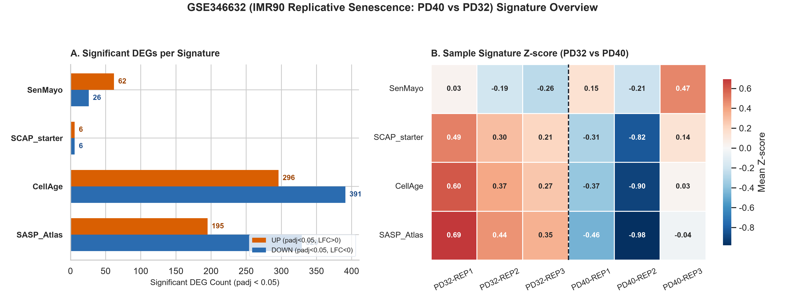
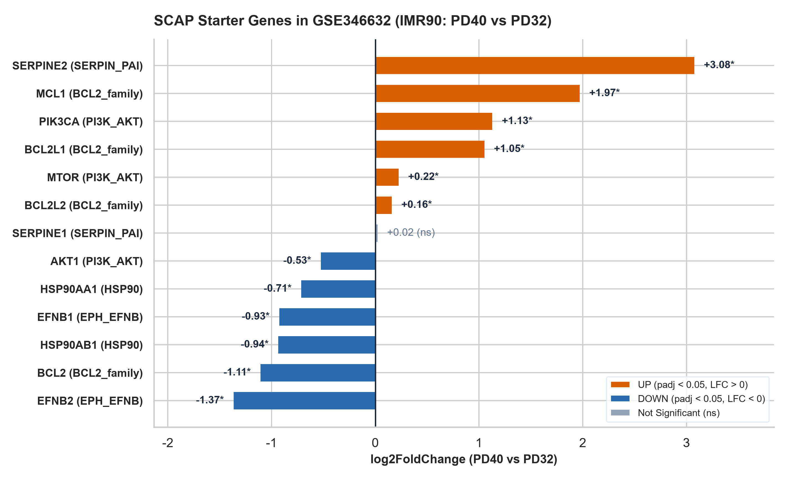

# Senolytic & SCAP Drug Repurposing Pipeline (`GSE346632`)

Human replicative senescence RNA-seq (`GSE346632`, IMR90 `PD40` vs `PD32`) differential expression, senescence/SCAP signature evaluation, and signature-reversal drug repurposing workflow.

## Pipeline Overview

1. **Differential Expression Analysis (`07_run_deg_gse346632.py`)**: `pyDESeq2` differential expression between `PD40` and `PD32`.
2. **Gene Mapping & Signature Profiling (`08_map_deg_and_check_signatures.py` ~ `12_plot_scap_lfc.py`)**: Gene symbol mapping and evaluation across `SCAP_starter` (13 genes), `SenMayo`, `CellAge`, and `SASP_Atlas`.
3. **Reversal Query & Drug Screening (`13_prepare_reversal_query.py` ~ `16_summarize_candidates.py`)**: `UP`/`DOWN` query generation, `L1000FWD` opposite-signature result parsing, and `ChEMBL` clinical phase / MOA annotation.
4. **Candidate Table Export (`20_export_candidates_table.py`)**: Export summary table (`results/l1000fwd/08_repurposing_candidates_table.md`).

## Key Visualizations

### 1. Senescence Signature Overview (`PD40` vs `PD32`)


### 2. SCAP Starter Genes (`log2FoldChange`)


## Data Sources & References

- **Transcriptomic Dataset:** NCBI GEO [`GSE346632`](https://www.ncbi.nlm.nih.gov/geo/query/acc.cgi?acc=GSE346632) (IMR90 replicative senescence, `PD40` vs. `PD32`).
- **Senescence & SCAP Gene Sets:** `SenMayo`, `CellAge`, `SASP Atlas`, and `SCAP_starter` gene sets used for signature profiling and SCAP context.
- **Perturbation & Drug Annotation:**
  - **L1000 / L1000FWD:** Opposite-signature perturbation screening.
  - **ChEMBL:** Clinical development phase (`max_phase`) and mechanism of action (`MOA`) annotation.
- **Disclaimer:** This pipeline is intended for exploratory computational drug repurposing research and requires experimental validation.

## Environment Setup

```bash
conda activate scap-repurposing
pip install -r requirements.txt

